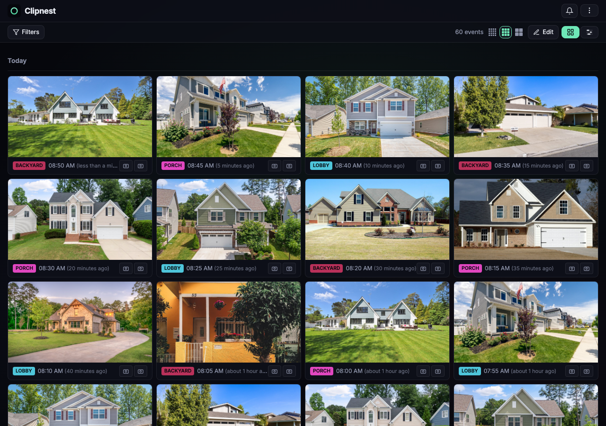
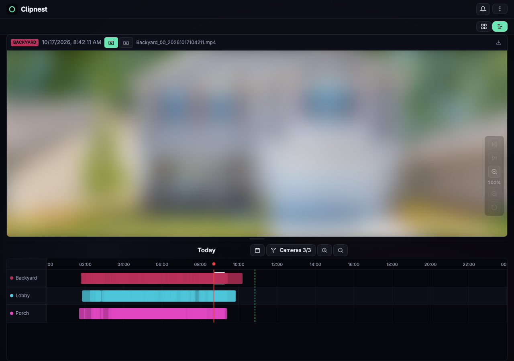

# OpenClipnest

Self-hosted storage and playback for your security-camera recordings.

Your cameras upload over FTP, OpenClipnest stores every recording encrypted,
and you browse them from a browser or the Clipnest apps — as a grid of clips
or on a per-camera timeline with instant seeking.




## What you get

- **Camera upload over FTP / FTPS.** File names from Reolink, Hikvision,
  Foscam and Axis cameras are recognised out of the box; other cameras work
  through a file-name pattern you define (see [Camera support](#camera-support)).
  Dual-lens cameras are merged into one event with two views.
- **Encrypted at rest.** Each recording is encrypted in object storage with a
  key derived from a secret only you hold.
- **Grid and timeline.** Thumbnails, filters by camera and time, bulk delete,
  frame stepping, zoom, and seeking that starts immediately even on long clips.
- **Space management.** Keep recordings for N days, and/or delete the oldest
  when a disk limit you set is reached.
- **Notifications** in the app, and optionally push notifications on your phone.
- **MCP endpoint** so an LLM client you approve can search and open your
  recordings.
- **One account.** The install has a single account, created on first start.
  Nobody can register.

OpenClipnest is the self-hosted, source-available core of [Clipnest](https://clipnest.video).
The hosted service adds things that only make sense for a service with many
customers — sign-up, plans, an admin panel, e-mail, passkeys and social
sign-in — and is not part of this repository.

## Install

1. **Get the code**

   ```bash
   git clone https://github.com/Axadiw/OpenClipnest.git
   cd OpenClipnest
   ```

2. **Write your settings into `.env`**

   ```bash
   cp .env.example .env
   ```

   Then edit `.env`. Every setting is explained in the file; these are the
   ones you must fill in:

   | Setting | What to put there |
   |---|---|
   | `ACCOUNT_EMAIL`, `ACCOUNT_PASSWORD` | Your sign-in. The password needs 12+ characters with an upper-case letter, a lower-case letter and a digit. |
   | `PUBLIC_URL` | The address you will open in the browser, e.g. `http://192.168.1.10:8080` — or `https://clips.example.com` once you turn on [HTTPS](#https-and-access-from-outside-your-network). |
   | `FTP_HOST` | The address **cameras** use to reach this machine, e.g. `192.168.1.10`. Never `localhost`. |
   | `DISK_LIMIT` | Optional, e.g. `500GB`. Empty means no limit. |
   | `ENCRYPTION_KEY`, `TOKEN_SECRET`, `INTERNAL_API_KEY`, `DATABASE_PASSWORD`, `STORAGE_PASSWORD` | Secrets you define. The command below fills in all five. |

   ```bash
   for n in ENCRYPTION_KEY TOKEN_SECRET INTERNAL_API_KEY DATABASE_PASSWORD STORAGE_PASSWORD; do sed -i.bak "s/^$n=''\$/$n='$(openssl rand -hex 32)'/" .env; done; rm -f .env.bak
   ```

   It only fills in values that are still empty, so running it again never
   replaces a secret. You can also generate each one by hand with
   `openssl rand -hex 32`.

   Write every value in single quotes, as `.env.example` does
   (`ACCOUNT_PASSWORD='…'`). Inside single quotes `$` and `#` are taken
   literally; without quotes Docker Compose expands `$NAME`, so a password like
   `Pa$sword1234` would silently become `Pa`. A value cannot contain a single
   quote.

   > **Back up `.env`, above all `ENCRYPTION_KEY`.** Every recording is
   > encrypted with a key derived from it. If you lose it, the recordings
   > cannot be recovered — not by you, and not by anyone else. Store a copy
   > somewhere other than this machine.

   Nothing is generated for you: Docker Compose refuses to start while a
   required setting is empty, and the server refuses to start while a secret
   is too short or still a placeholder, and tells you which one.

3. **Start it**

   ```bash
   docker compose up -d --build
   ```

   The first start builds the images from source, creates the database and
   your account. On a 2-CPU machine the build takes about 5–8 minutes and
   downloads roughly 1 GB; on a NAS or a small ARM board it takes longer (see
   [NAS, Docker Desktop and ARM](#nas-docker-desktop-and-arm)). Later starts
   take seconds.

4. **Sign in** at the address you set as `PUBLIC_URL`.

If something does not come up, `docker compose ps` shows which service is not
running and `docker compose logs clipnest-api` usually says why.

`.env` is not tracked by git, so `git pull` never conflicts with your
settings. If you want to add services or change something in
`docker-compose.yml`, put it in `docker-compose.override.yml` (Compose reads it
automatically, and git ignores it) instead of editing `docker-compose.yml`.

## Connect a camera

In the camera's FTP settings:

| Field | Value |
|---|---|
| Server | the `FTP_HOST` address |
| Port | `21` (or your `FTP_PORT`) |
| User name | your account e-mail |
| Password | your account password |
| Encryption | FTPS / "explicit TLS" if the camera offers it, otherwise plain FTP |

Then trigger a recording. It appears in the grid within a few seconds of the
upload finishing.

**Prefer FTPS.** Plain FTP sends your account password — the one you also
sign in with — unencrypted over the network, together with the recordings.
Use it only for cameras that cannot do FTPS, on a network you trust. The FTP
server's certificate is self-signed; cameras accept it.

**If uploads fail, it is almost always passive mode.** FTP transfers open a
second connection to the address in `FTP_HOST` on ports `30000-30099`. That
address must be reachable from the camera, and those ports must not be
blocked by a firewall between the camera and this machine.

### Camera support

OpenClipnest finds the camera and the time of a recording in its file name.
With **Settings → Camera file recognition → Auto** (the default) these names
are recognised:

| Cameras | File names like |
|---|---|
| Reolink, and others that name files the same way | `Driveway_00_20261015143022.mp4` — on dual-lens models `_00_` is the wide and `_01_` the zoom lens, merged into one event |
| Hikvision | `Webcam_G12345678_20261015143022.mp4` |
| Foscam | `MDAlarm_20261015-143022.mp4` |
| Axis | `Driveway_2026-10-15_14-30-22.mp4` |
| Any camera | `Driveway_20261015143022.mp4` |

For other cameras, switch to **Custom** on the same page and describe your
camera's file names with a pattern; the page tests a pattern against a file
name before you save it. Recordings must be MP4 files.

A file whose name matches no pattern, or that is not an MP4, is stored and
counts toward the disk limit, but it does not appear: the grid keeps saying
"No recordings yet". Unrecognised files are retried for a week, so a pattern
you add later still picks them up.

### Sign-in lockouts

Five wrong passwords in a row lock that way of signing in for a while. The web
app and the apps are counted separately from FTP: a camera still using an old
password locks out FTP, never your sign-in, and the other way round. A correct
sign-in resets the count of that way of signing in.

A lockout lasts 1 minute, then 2, 4, 8 … each one in a row doubling. For the
first eight it stops at 60 minutes for the web app and the apps and at 15
minutes for FTP, so a camera with an outdated password is back soon after you
fix it. If it goes on past that — guessing rather than a forgotten camera —
the lockouts double again, up to 24 hours.

Many failed FTP logins from one network address (20 within 15 minutes) also
pause FTP logins from that address for 15 minutes, doubling up to 24 hours if
it repeats.

Changing `ACCOUNT_PASSWORD` (see [Day to day](#day-to-day)) clears the
lockouts of your account and lifts a pause it caused on a network address. To
clear everything without changing the password, paused addresses included:

```bash
docker compose exec clipnest-api node dist/scripts/reset-user-ban.js you@example.org
```

## HTTPS and access from outside your network

OpenClipnest serves plain HTTP on port 8080. That is fine at home. For access
from outside — and for the iOS and macOS apps, which only allow plain HTTP to
addresses on the local network — you need HTTPS. It is built in: OpenClipnest
gets a free certificate from Let's Encrypt for your own domain and renews it
by itself.

You need:

- a domain name, such as `clips.example.com`, that points at this machine's
  public address (a dynamic-DNS name works too);
- ports 80 and 443 of this machine reachable from the internet. Port 80 is how
  Let's Encrypt checks that the domain is yours; it also sends `http://` to
  `https://`.

Then, in `.env`:

1. Set `PUBLIC_URL` to your domain with `https://`, no port and no path:
   `PUBLIC_URL='https://clips.example.com'`.
2. Add `https` to `COMPOSE_PROFILES`: `COMPOSE_PROFILES='bundled-storage,https'`
   (just `'https'` with [your own object storage](#your-own-object-storage)).
3. Optionally set `WEB_PORT='127.0.0.1:8080'`, so plain HTTP is only reachable
   from this machine.

Then run `docker compose up -d`. The first certificate usually arrives within a
minute; after that, open `https://clips.example.com`. The apps use the same
address (see [Mobile and desktop apps](#mobile-and-desktop-apps)).

If it does not come up, `docker compose logs caddy` says why. The usual causes
are a DNS record that does not point at this machine (yet) and ports 80 or 443
that do not reach it from the internet. The certificate is kept in a volume,
so restarts and upgrades do not ask Let's Encrypt for a new one.

Good to know:

- The domain has to lead to this machine from inside your own network too. If
  your router cannot reach its own public address from inside (NAT loopback),
  point the domain at this machine's local address in your local DNS.
- Ports 80 and 443 must be free on this machine. If something else already
  uses them, such as a NAS web interface, use a proxy of your own (below).

### A proxy of your own

Any proxy works — nginx, Traefik, your own Caddy, a tunnel. Leave `https` out
of `COMPOSE_PROFILES`, and:

- forward to port 8080 of this machine. The bottom of `docker-compose.yml` has
  a ready-to-adapt nginx example that goes into `docker-compose.override.yml`;
- set `PUBLIC_URL` to the `https://` address and run `docker compose up -d`;
- serve OpenClipnest at the root of a host name, such as
  `https://clips.example.com/`. A sub-path such as `https://example.com/clips/`
  does not work: the web app, its API calls and the MCP discovery documents
  all use absolute paths from the root;
- keep response buffering off in the proxy, or video playback stalls;
- optionally set `WEB_PORT='127.0.0.1:8080'`, so plain HTTP is only reachable
  from this machine.

### Self-signed certificates and private CAs

With the built-in HTTPS the certificate is publicly trusted and the apps need
nothing special; this section is for a certificate of your own.

The apps check the server's certificate the way a browser does:

- **iPhone, iPad, Mac and Windows** trust what the operating system trusts. A
  certificate from your own CA works once that CA is installed as trusted on
  the device (on iPhone and iPad: install the profile, then turn on full trust
  under Settings → General → About → Certificate Trust Settings).
- **Android** trusts the CAs built into Android and the CAs you install
  yourself (Settings → Security → Encryption & credentials → Install a
  certificate → CA certificate), so a certificate from your own CA works there
  too. A publicly trusted certificate — Let's Encrypt can issue one for a home
  server through a DNS challenge — avoids installing anything.
- When the app cannot trust the certificate it says so and tells you to use a
  public CA or install your own; a problem that is not about the certificate
  shows up as "couldn't reach the server".

## Mobile and desktop apps

The Clipnest apps for iOS, iPadOS, Android, macOS, Windows and Apple TV can
connect to your own server: choose **Own server** on the sign-in screen and
enter your `PUBLIC_URL`. They hide what a self-hosted server does not offer.

**Apple TV** signs in to your server with a code, so you only type the address
with the remote: the TV shows a code and `<your address>/tv`; open that
address on your phone or computer, sign in and enter the code. E-mail and
password remain available as a fallback.

**Analytics** stay off while an app is connected to your own server, and
nothing the apps report can contain your server's address.

**Push notifications** reach the iPhone and iPad app and the Android app. The
macOS, Windows and Apple TV apps show notifications inside the app only. On
Android, push needs Google Play services.

Push goes through the Clipnest push relay, because only the app's publisher
can deliver notifications to it. Your server sends the relay an end-to-end
encrypted message that only your phone can read; the relay never sees camera
names or recordings. Push is optional: set
`PUSH_RELAY_URL='https://push.clipnest.video'` in `.env` and run
`docker compose up -d` to turn it on, or leave it empty to run without it.

**Storage** in the apps shows no limit unless you set `DISK_LIMIT`.

**Signing out** of the web app signs out every device on the account — the
apps and any other browser — and disconnects MCP clients, which then have to
be approved again. This is deliberate: a sign-out never leaves a forgotten
session behind.

## Day to day

**Change the disk limit** — edit `DISK_LIMIT` in `.env`, then
`docker compose up -d`.

**Change or recover the password** — edit `ACCOUNT_PASSWORD` in `.env`, then
`docker compose up -d`. The password in `.env` is applied on every start;
changing it signs out every device and clears the sign-in lockouts of the account. Cameras
use the same password, so update them too. There is no e-mail reset and no
password screen in the app. The account e-mail cannot be changed after the
first start.

### Upgrade

```bash
git pull
docker compose up -d --build
```

Database changes are applied automatically on start. Read the release notes
on the [Releases page](https://github.com/Axadiw/OpenClipnest/releases) first:
if a release needs an extra step, they say so.

The images build on pinned base images. To also pick up the newest operating
system packages for them (security fixes), rebuild without the cache now and
then:

```bash
docker compose build --pull --no-cache
docker compose up -d
```

**Installed before settings moved to `.env`?** If your `docker-compose.yml`
starts with a SETTINGS block, `git pull` stops because you edited that file.
Move your settings once:

1. Keep a copy of your settings: `cp docker-compose.yml ~/openclipnest-compose-backup.yml`
2. Undo your edits and update: `git checkout -- docker-compose.yml && git pull`
3. `cp .env.example .env`, then copy each value from the SETTINGS block of
   your backup into `.env`. The names are the same in capitals
   (`account_email` → `ACCOUNT_EMAIL`, `push_relay_url` → `PUSH_RELAY_URL`,
   …). A `$$` in the old file is a single `$` in `.env`.
4. Anything else you had added to `docker-compose.yml`, such as the HTTPS
   proxy, goes into `docker-compose.override.yml`.
5. `docker compose up -d --build`. Your data is kept: the volumes are the same.

### Back up

- **`.env`** — above all `ENCRYPTION_KEY`.
- **The database:**

  ```bash
  docker compose exec -T clipnest-db pg_dump -U clipnest clipnest > clipnest.sql
  ```

- **The recordings**, if you want the recordings themselves. With the bundled
  storage they live in the `recordings` volume (named after this folder, e.g.
  `openclipnest_recordings` — check with `docker volume ls`), or in your
  `RECORDINGS_DIR`. Copy them while the stack is stopped:

  ```bash
  docker compose stop
  docker run --rm -v openclipnest_recordings:/data:ro -v "$PWD":/backup alpine:3.24.2 \
      tar -czf /backup/recordings.tar.gz -C /data .
  docker compose start
  ```

The database and the encryption key are both required to read the
recordings. Either one alone is not enough. Redis, the generated certificates
and the HTTPS certificate need no backup; they are recreated. (A CA certificate
you copied in for [your own object storage](#your-own-object-storage) is not:
keep the file and copy it in again after a restore.)

### Restore

On a new machine (or after removing the volumes), in a fresh clone of the same
or a newer version:

1. Put your backed-up `.env` next to `docker-compose.yml`. It must have the
   same `ENCRYPTION_KEY`.
2. Create the containers and volumes without starting anything:
   `docker compose up --no-start --build`
3. If you backed up the recordings, put them back before the first start:

   ```bash
   docker run --rm -v openclipnest_recordings:/data -v "$PWD":/backup alpine:3.24.2 \
       tar -xzf /backup/recordings.tar.gz -C /data
   ```

   (With `RECORDINGS_DIR`, copy the files back into that directory instead.)
4. Restore the database into the still-empty database:

   ```bash
   docker compose up -d --wait clipnest-db
   docker compose exec -T clipnest-db psql -U clipnest -d clipnest -v ON_ERROR_STOP=1 < clipnest.sql
   ```

   This has to happen before the rest of the stack starts for the first time.
   If it already did, stop it with `docker compose down`, remove only the
   database volume (`docker volume rm openclipnest_database`) and repeat from
   step 2.
5. `docker compose up -d`. The server applies the database changes of newer
   versions and signs you in with the password from `.env`.

### Secrets

What happens when you change a secret in `.env` and run `docker compose up -d`:

| Setting | Effect |
|---|---|
| `ENCRYPTION_KEY` | **Cannot be changed.** Recordings are encrypted with keys derived from it; with a different key the existing recordings cannot be read. |
| `TOKEN_SECRET` | Every session in the web app and the apps ends; sign in again. Approved MCP clients keep working. |
| `INTERNAL_API_KEY` | Nothing visible: every service picks up the new value together. |
| `DATABASE_PASSWORD` | The database keeps the password it was created with, so changing only `.env` locks the server out of its database. Change it in the database first, then put the same value in `.env`: `docker compose exec -T clipnest-db psql -U clipnest -d clipnest -c "ALTER USER clipnest PASSWORD 'the-new-value'"` |
| `STORAGE_USER`, `STORAGE_PASSWORD` | With [your own object storage](#your-own-object-storage): create the new key there first, then change `.env`. With the bundled storage this is untested; leave them as they are. |

## Storage

### Recordings on a host directory

The bundled storage keeps its data in a Docker volume. To put it on a
particular disk instead — a NAS share, a RAID — set `RECORDINGS_DIR` in `.env`
to an absolute path (or one starting with `./`) before the first start. The
files there are the storage server's own format, encrypted: they are for
backups, not for browsing.

To move an existing install there: `docker compose down`, copy the volume's
contents into the directory, set `RECORDINGS_DIR`, `docker compose up -d`:

```bash
docker run --rm -v openclipnest_recordings:/from:ro -v /srv/clipnest:/to alpine:3.24.2 cp -a /from/. /to/
```

### Your own object storage

Recordings can live in any S3-compatible object storage instead of the bundled
MinIO, as long as it:

- supports **SSE-C** (server-side encryption with keys supplied by the
  client) — many stores do not, so check first;
- is reached over **HTTPS** (SSE-C is only accepted over TLS);
- accepts **path-style** requests signed for the region **`us-east-1`** (on
  AWS S3 that means a bucket in us-east-1);
- has **three buckets** you created for recordings, thumbnails and playback
  data.

OpenClipnest is tested with the bundled storage only.

In `.env`, empty `COMPOSE_PROFILES` (keep the line) so the bundled MinIO does
not run, and fill in the storage lines at the end of the file:

```bash
COMPOSE_PROFILES=''
STORAGE_ENDPOINT='https://s3.example.com'
STORAGE_USER='your-access-key'
STORAGE_PASSWORD='your-secret-key'
STORAGE_RECORDINGS_BUCKET='clips-recordings'
STORAGE_THUMBNAILS_BUCKET='clips-thumbnails'
STORAGE_SIDECARS_BUCKET='clips-sidecars'
STORAGE_CA_BUNDLE='/etc/ssl/certs/ca-certificates.crt'
```

`STORAGE_CA_BUNDLE` is a path inside the containers, and it must be set: the
FTP server trusts only the certificates in that file when it talks to the
object storage. The file may hold any number of certificates in PEM format.
For a publicly trusted certificate use the system list shown above. For a
certificate from your own CA, copy the CA certificate into the `certs` volume
and point at it:

```bash
docker compose run --rm -T --no-deps --entrypoint sh init-certs -c 'cat > /certs/storage-ca.crt' < my-ca.crt
```

and set `STORAGE_CA_BUNDLE='/certs/storage-ca.crt'`. The file must be PEM
(text starting with `-----BEGIN CERTIFICATE-----`); a binary (DER) or empty
file counts as "no certificates", and every upload then fails.

Switching an existing install between the bundled storage and your own does
not move any recordings.

## NAS, Docker Desktop and ARM

- **Windows.** Use Docker Desktop with WSL 2 and clone the repository inside
  WSL. The repository keeps the scripts that run inside the containers on LF
  line endings; a script with Windows line endings fails there.
- **Docker Desktop (Windows, macOS)** is fine for trying OpenClipnest out.
  Cameras connect to the computer's network address (`FTP_HOST`), so allow
  ports 21 and 30000–30099 through the computer's firewall, and keep the
  computer on. Keep the recordings in the default volume: `RECORDINGS_DIR` on
  the host file system is slow there.
- **NAS.** You need Docker with Compose v2.20 or newer on the NAS. Some NAS
  systems use port 8080 for their own admin page (set `WEB_PORT`) or run their
  own FTP server on port 21 (turn it off, or set `FTP_PORT` and use that port
  in the cameras). Ports 30000–30099 must be free. The built-in
  [HTTPS](#https-and-access-from-outside-your-network) also needs ports 80 and
  443; if the NAS uses them for its own web interface, give OpenClipnest's
  port 8080 to the NAS's reverse proxy instead. `RECORDINGS_DIR` can point at
  a shared folder. The first build is slow on NAS processors.
- **ARM64** (Raspberry Pi, ARM-based NAS). The base images and ffmpeg exist
  for arm64, but this setup is untested there. The first build compiles the
  FTP server and the web app from source: expect it to take much longer than
  on x86, and use a board with 4 GB of memory or more.

No prebuilt images are published; every install builds them from this
repository.

## Contributing

Bug reports and pull requests are welcome — see [CONTRIBUTING.md](CONTRIBUTING.md).
Before a pull request can be merged you will be asked to sign the
[contributor licence agreement](CLA.md); a bot walks you through it.

Security problems: see [SECURITY.md](SECURITY.md). Please do not open a public
issue for them.

## Licence

[PolyForm Noncommercial License 1.0.0](LICENSE). The source is public, but it
is not an open-source licence:

- **Free** for any noncommercial use — your home, hobby projects, personal
  study, and charities, schools, research and public institutions.
- **Not allowed without a commercial licence:** any commercial use. That
  includes running OpenClipnest in or for a business, installing it for paying
  customers, and offering it to others as a hosted service.

For a commercial licence, write to [admin@clipnest.video](mailto:admin@clipnest.video).

"Clipnest" and the Clipnest logo are trademarks and are not covered by that
licence — see [TRADEMARK.md](TRADEMARK.md).
